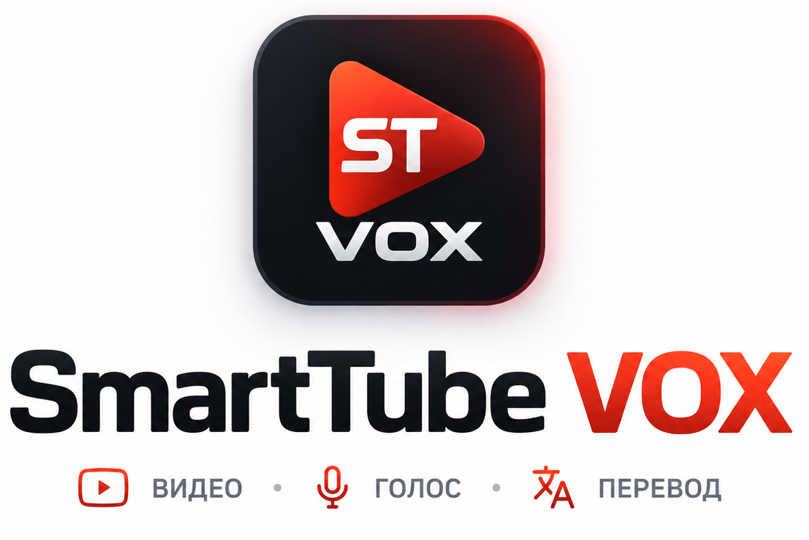
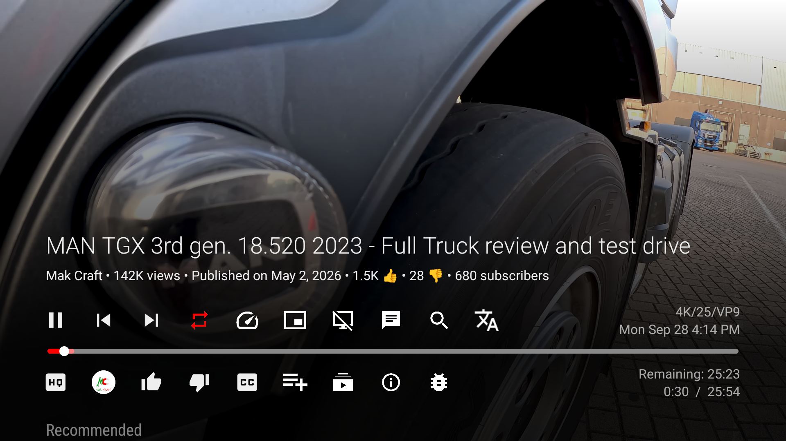

  

# SmartTube VOX

  <strong>SmartTube VOX — это медиаплеер для телевизоров и ТВ-приставок с Android TV и Google TV. Приложение создано для комфортного просмотра YouTube на большом экране: в него встроен нейросетевой закадровый перевод на русский язык, возможность скачивать видео для просмотра без интернета, интерфейс под пульт ДУ и защита от рекламы.</strong>

  <a href="https://github.com/Kiryuhak/SmartTube-Vox/releases/latest"><strong>📥 Скачать последнюю версию</strong></a> ·
  <a href="CHANGELOG.md">📋 История изменений</a> ·
  <a href="https://github.com/Kiryuhak/SmartTube-Vox/issues">❓ Сообщить об ошибке</a>

  
  
  
  

---

## 🧭 Чем SmartTube VOX отличается от оригинального SmartTube

Оригинальный [SmartTube](https://github.com/yuliskov/SmartTube) — популярный плеер YouTube для телевизоров без рекламы.

**SmartTube VOX** развивает эти возможности и добавляет уникальный набор функций:

1. **Встроенный голосовой перевод (VOX):** автоматический закадровый перевод иностранных видеороликов на русский язык прямо во время просмотра без установки дополнительных плагинов.
2. **Скачивание видео со звуковой дорожкой перевода:** возможность сохранять видеоролики в память ТВ или на USB-накопитель сразу с русской озвучкой и смотреть их без доступа к сети.
3. **Раздел «Скачанные видео» в боковой панели:** быстрый доступ к сохранённой медиатеке прямо с главного экрана, с сохранением пользовательских настроек отображения.
4. **Интеллектуальная панель управления плеера:** компактная индикация реального прогресса перевода в кнопке плеера и информативные подсказки без перекрытия видео.
5. **Повышенная стабильность воспроизведения:** встроенные механизмы автоматического восстановления при сетевых ошибках потоков (включая ошибки доступа 403) и плавная перемотка.
6. **Безопасная диагностика сбоев:** возможность отправить разработчикам анонимный технический отчёт для быстрого устранения несовместимостей на редких моделях телевизоров.
7. **Параллельная установка:** приложение использует собственный идентификатор пакета (`io.github.kiryuhak.smarttubevot.stable`), поэтому может работать одновременно с оригинальным SmartTube, не заменяя его и не затирая его настройки.

---

## 📺 Основные возможности

- **Просмотр без рекламы:** поддержка блокировки встроенной рекламы YouTube и спонсорских интеграций (SponsorBlock).
- **Высокое качество видео:** поддержка разрешений 1080p, 4K, 60fps, HDR, цветовых профилей и современных видеокодеков (AV1, VP9, HEVC) в зависимости от возможностей экрана и чипсета.
- **Адаптивная частота кадров (AFR):** автоподстройка частоты развёртки телевизора под частоту кадров видео для устранения подёргиваний изображения (judder).
- **Фоновое воспроизведение:** звук продолжает воспроизводиться при выходе на домашний экран Android TV или при отключении дисплея (режим аудио).
- **Удобное управление пультом:** интерфейс спроектирован специально для пульта ДУ (D-Pad), с быстрым доступом к поиску, подпискам, истории и настройкам.
- **Поддержка официального дубляжа:** если автор видео уже предоставил официальную русскую звуковую дорожку, приложение автоматически предложит воспроизвести её.

---

## 📱 Для каких устройств предназначено приложение

SmartTube VOX работает на любых устройствах под управлением **Android TV** и **Google TV** с версией системы **Android 5.0 (Lollipop) и новее** (Android 5–14):

- **Телевизоры:** TCL, Xiaomi / Redmi TV, Sony Bravia, Philips, Hisense, Haier, Realme TV, а также ТВ на базе Яндекс ТВ, Салют ТВ и других сборок AOSP.
- **ТВ-приставки и медиаплееры:** Xiaomi Mi Box / TV Stick, Google Chromecast with Google TV, Nvidia Shield TV, Realme 4K Smart Google TV Stick, Dune HD, Ugoos, TOX и многие другие.
- **Проекторы:** умные проекторы на базе Android TV (XGIMI, Wanbo, Dangbei, Formovie).
- **Amazon Fire TV:** поддерживается через установку APK.

> [!NOTE]
> Приложение оптимизировано для управления пультом дистанционного управления телевизора и не предназначено для сенсорных экранов смартфонов или планшетов.

---

## 📸 Скриншоты интерфейса

  
  
<em>Интерфейс видеоплеера с кнопкой закадрового перевода и информационным оверлеем</em>

---

## 📥 Загрузка приложения

Все актуальные установочные пакеты доступны на официальной странице выпусков:

👉 **[Перейти к странице релизов SmartTube VOX](https://github.com/Kiryuhak/SmartTube-Vox/releases/latest)**

### Какой файл APK выбрать для установки?

Вам нужен только **один** файл из списка, соответствующий процессору вашего устройства:

| Файл APK | Для каких устройств | Рекомендация |
| :--- | :--- | :--- |
| **`SmartTube_vot_..._universal.apk`** | Все типы процессоров и ТВ | **Рекомендуется по умолчанию**, если вы не уверены в точной архитектуре процессора телевизора. Включает библиотеки для всех систем. |
| **`SmartTube_vot_..._armeabi-v7a.apk`** | 32-битные процессоры ARM | Для подавляющего большинства телевизоров и ТВ-приставок (TCL, Xiaomi Mi Box / Stick, Realme, базовые медиаплееры). Занимает меньше места. |
| **`SmartTube_vot_..._arm64-v8a.apk`** | 64-битные процессоры ARM | Для мощных приставок и флагманских ТВ (Nvidia Shield TV, современные производительные боксы). |
| **`SmartTube_vot_..._x86.apk`** | Процессоры Intel / AMD | Для эмуляторов Android на ПК и редких медиаустройств на архитектуре x86. |

---

## 🚀 Установка и первое использование

### Вариант 1. Установка через флешку (USB-накопитель)
1. Скачайте нужный файл `.apk` с [GitHub Releases](https://github.com/Kiryuhak/SmartTube-Vox/releases/latest) на компьютер.
2. Скопируйте файл на USB-флешку.
3. Подключите флешку к телевизору или ТВ-приставке.
4. Откройте любой файловый менеджер на ТВ (например, *X-plore File Manager*, *FX File Explorer* или стандартный проводник).
5. Найдите и запустите файл APK.
6. Если система запросит разрешение на установку из неизвестных источников, подтвердите его в настройках безопасности Android.
7. Дождитесь завершения установки и откройте приложение.

### Вариант 2. Установка через приложение «Downloader» на ТВ
1. Установите приложение **Downloader by AFTVnews** из Google Play Store на вашем телевизоре.
2. В браузере Downloader откройте страницу релизов `https://github.com/Kiryuhak/SmartTube-Vox/releases/latest` или введите прямую ссылку на нужный APK.
3. Дождитесь загрузки и подтвердите установку приложения.

> [!TIP]
> Приложение устанавливается с идентификатором `io.github.kiryuhak.smarttubevot.stable`. Оно не перезаписывает оригинальный SmartTube и может работать параллельно с ним.

---

## 🎙 Настройка и использование голосового перевода

### Как включить перевод в видео:
1. Запустите любое иностранное видео.
2. Нажмите стрелку вниз или кнопку выбора на пульте, чтобы открыть панель управления плеером.
3. Найдите кнопку с иконкой перевода (**文A** / значок перевода).
4. Нажмите кнопку — начнётся процесс подготовки перевода:
   - В кнопке появится кольцевой индикатор с процентами выполнения (`%`).
   - На экране кратковременно (на 3.5 секунды) появится аккуратная всплывающая подсказка с текущим этапом (*«Определяем язык…»*, *«Готовим перевод…»*, *«Подключаем перевод…»*).
   - Как только дорожка готова, иконка подсветится, и видео продолжит играть с закадровым русским переводом.

### Основные настройки перевода (**Настройки → Голосовой перевод**):
- **Автоперевод:** при включении этой опции приложение будет автоматически запрашивать русскую озвучку для всех иностранных роликов при их открытии.
- **Пауза при подготовке:** автоматически ставит видео на паузу во время ожидания генерации перевода, чтобы вы не пропустили начало ролика.
- **Баланс громкости:** позволяет настроить громкость оригинального звука (например, 5–10%) и громкость речи переводчика (100%), создавая эффект комфортного закадрового дубляжа.
- **Мгновенный старт кэшированного перевода:** если перевод для этого видео уже запрашивался вами или другими пользователями ранее, русская дорожка начинает звучать практически сразу без ожидания генерации.
- **Режим «Живой голос» (Яндекс ID):** авторизация через короткий код на экране (`ya.ru/device`) позволяет подключить дополнительные нейросетевые голоса Яндекса. *Авторизация добровольна: базовый перевод работает без входа в аккаунт.*

> [!NOTE]
> Генерация нового перевода выполняется облачными нейросетевыми сервисами. Скорость подготовки зависит от продолжительности ролика, загруженности серверов и качества интернет-соединения.

---

## 📥 Скачивание и оффлайн-просмотр

SmartTube VOX умеет сохранять видеоролики на встроенную память телевизора или подключённый внешний накопитель:

1. **Скачивание с переводом:**
   - В меню карточки видео или в меню плеера выберите пункт **«Скачать видео»**.
   - Выберите желаемое качество и подтвердите загрузку. Если для видео доступен перевод, файл будет сохранён в формате MKV с двумя аудиодорожками (оригинальная и русская речь).
2. **Раздел «Скачанные видео»:**
   - Раздел располагается в главном боковом меню (sidebar) приложения.
   - Список скачанных роликов доступен для просмотра даже при полном отключении интернета.
   - При воспроизведении скачанного ролика русская дорожка перевода активируется автоматически.
3. **Управление памятью:**
   - В меню **Настройки → Скачанные видео** отображается объём занятого и свободного места на диске с возможностью удаления просмотренных файлов.
   - Состояние видимости раздела «Скачанные видео» в боковой панели надёжно сохраняется между перезапусками приложения.

---

## 🎮 Интерфейс и управление с пульта

Интерфейс SmartTube VOX оптимизирован для комфортного использования одной рукой с любого пульта ТВ:

- **Стрелки (D-Pad):** плавная навигация по сетке видео, боковому меню и элементам управления.
- **Кнопка OK / Выбор:** воспроизведение, пауза, активация кнопок меню.
- **Кнопка Назад:** скрытие панели управления плеера, возврат на главный экран без зависания старых заголовков.
- **Длительное нажатие OK:** открытие контекстного меню карточки видео (скачивание, добавление в плейлист, переход к каналу).
- **Настройка бокового меню:** через меню настроек интерфейса можно скрыть ненужные разделы или упорядочить категории по своему вкусу.

---

## 🔄 Обновление приложения

SmartTube VOX оснащён встроенным механизмом проверки и установки обновлений без необходимости повторного использования флешки:

- **Канал Stable (Стабильный):** проверенные версии для повседневного семейного просмотра. Обновления выходят реже и проходят длительную проверку надёжности.
- **Канал Beta (Предварительный):** свежие версии с новыми возможностями и улучшениями.
- **Проверка обновлений:** в любое время доступна в меню **Настройки → О приложении → Проверить обновления**.

---

## 🛠 Решение распространённых вопросов (FAQ)

### Видео прерывается или выдаёт сетевую ошибку (HTTP 403 / буферизация)?
Приложение автоматически выполняет сброс кэша сегментов и переподключение к альтернативным потокам YouTube. Если сбой повторяется, проверьте стабильность интернет-соединения (предпочтительно подключение кабелем Ethernet или Wi-Fi 5 ГГц) или в меню **Настройки → Совместимость устройства** выберите более лёгкий видеокодек (например, AVC вместо AV1).

### Почему перевод иногда готовится дольше обычного?
Если для ролика ещё не существует готового перевода на сервере, нейросеть расшифровывает и переводит видео с нуля в реальном времени. Время ожидания зависит от длины ролика и нагрузки на сторонний сервер перевода.

### Не появляется русская дорожка при воспроизведении скачанного видео?
Убедитесь, что при скачивании был выбран вариант сохранения с переводом, и файл был загружен полностью. В плеере также можно вручную нажать кнопку перевода или выбрать звуковую дорожку в меню параметров звука.

### Как перенести настройки на другой телевизор?
В меню **Настройки → Резервное копирование и восстановление** можно сохранить резервную копию настроек во внутреннюю память устройства или восстановить её.

---

## 🔒 Конфиденциальность и диагностика

SmartTube VOX придерживается строгой политики защиты конфиденциальности:

### Что отправляется в техническом отчёте:
- Модель устройства и версия Android (например, *TCL 65C745, Android 12*);
- Поддерживаемые чипсетом видеодекодеры и звуковые форматы;
- Технический код ошибки плеера (например, таймаут видеопотока или сбой декодера);
- Задержка запуска видео и параметры буферизации.

### Что СТРОГО И НАВСЕГДА ИСКЛЮЧЕНО из отчётов:
- Названия просмотренных роликов и поисковые запросы;
- Ссылки на видео и сетевые адреса (URL);
- Логины, пароли, токены авторизации и cookies;
- Тексты субтитров и звук видео;
- IP-адреса, MAC-адреса и параметры домашней сети.

> [!NOTE]
> В стабильном канале отчёты отправляются **исключительно по вашему прямому желанию** при нажатии кнопки «Отправить отчёт разработчикам» в меню **Настройки → Совместимость устройства**. При отправке на экране отображается короткий номер отчёта (например, `VOX-A1B2C3`), который можно указать при создании вопроса на [GitHub Issues](https://github.com/Kiryuhak/SmartTube-Vox/issues).

---

## 💻 Для разработчиков

Техническая документация по архитектуре, тестированию и сборке проекта вынесена в специализированные документы каталога `docs/`:

- [Сборка проекта из исходного кода](docs/BUILDING.md)
- [Архитектура и жизненный цикл оверлея плеера (HUD)](docs/HUD_LIFECYCLE.md)
- [Политика автоматической телеметрии в предварительных версиях](docs/BETA_DIAGNOSTICS_POLICY.md)
- [Матрица совместимости кодеков и сетевых транспортов ТВ](docs/VOX_COMPATIBILITY_AUDIT.md)
- [Правило предотвращения дублирования данных](docs/ANTI_DUPLICATION_RULE.md)
- [Синхронизация с upstream VOT userscript](docs/vot-upstream-sync.md)

---

## 📜 Лицензия и благодарности

- Проект основан на оригинальном открытом медиаплеере [SmartTube](https://github.com/yuliskov/SmartTube) от **yuliskov**.
- Функционал голосового перевода разработан на базе технологий закадрового перевода [vsvoice/SmartTube](https://github.com/vsvoice/SmartTube) и сообщества Voice-Over-Translation (VOT).
- Исходный код распространяется под свободной лицензией [MIT](LICENSE).
