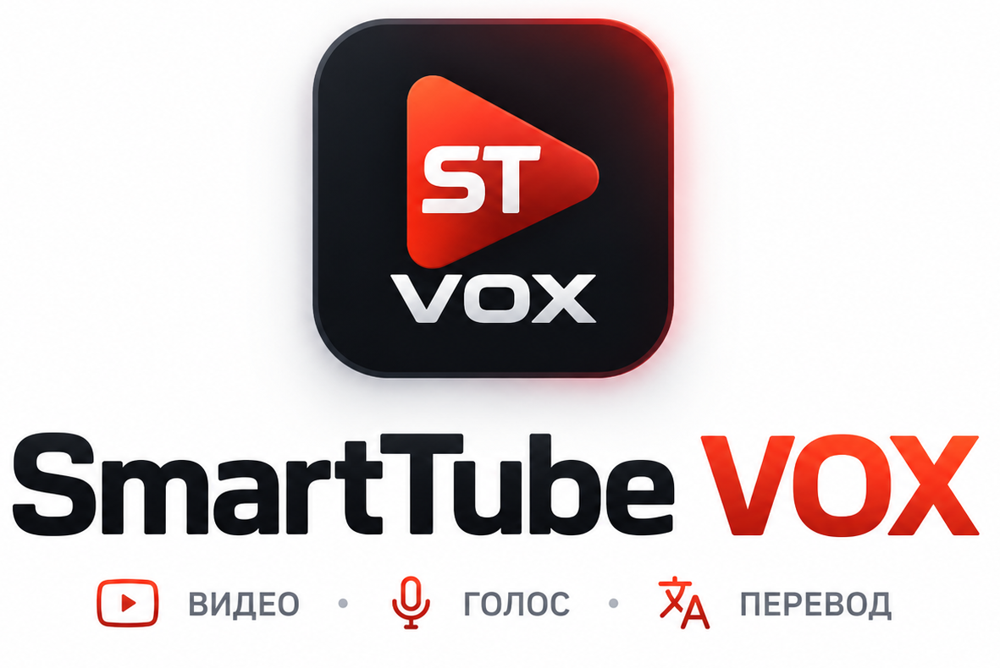
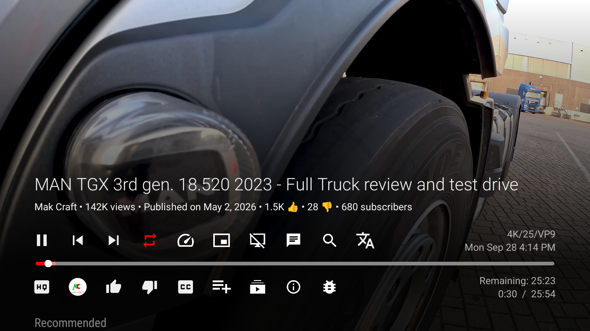

  

# SmartTube VOX 11

  <strong>SmartTube VOX — современный медиаплеер для телевизоров и ТВ-приставок с Android TV и Google TV. Приложение создано для максимально комфортного просмотра YouTube на большом экране: в него встроен нейросетевой закадровый перевод видео на русский язык, скачивание роликов с русской озвучкой для оффлайн-просмотра, интуитивное управление с пульта ДУ и блокировка рекламы.</strong>

  <a href="https://github.com/Kiryuhak/SmartTube-Vox/releases/latest"><strong>📥 Скачать релиз 32.71-vox.11</strong></a> ·
  <a href="CHANGELOG.md">📋 История изменений</a> ·
  <a href="https://github.com/Kiryuhak/SmartTube-Vox/issues">❓ Сообщить об ошибке</a>

  
  
  
  
  

---

## 🌟 Главные улучшения в версии VOX 11 (32.71-vox.11)

- **Обновление кодовой базы до SmartTube 32.71:** плеер синхронизирован с базовой версией 32.71, обновлены внутренние парсеры видеопотоков YouTube и улучшена совместимость с современными кодеками.
- **Стабилизированный движок Voice Over Tube (VOT 1.12.6):** зафиксирована и проверена стабильная версия 1.12.6 библиотеки закадрового перевода. Обеспечена надёжная синхронизация русской аудиодорожки, плавная работа с аккаунтами Яндекс и корректная привязка звука.
- **Восстановление воспроизведения VOD (DASH / SABR Streams):** внедрены механизмы автоматического отката (fallback) при ошибках старта воспроизведения потоков YouTube (HTTP 400) с переключением на альтернативные рабочие форматы и защитой от циклических перезагрузок.
- **Исправление стабильности звука при изменении скорости:** устранена рассинхронизация и дрожание тональности звука (pitch/tempo) при воспроизведении на скоростях от 1.0x до 2.0x с включённым закадровым переводом.
- **Приоритет голосового перевода Яндекс VOT:** при наличии в видео встроенного русского дубляжа YouTube обеспечен корректный выбор и приоритет нейросетевого перевода Яндекс VOT.
- **Повышенная надёжность Live и DVR трансляций:** улучшена стабильность прямого эфира, перемотка назад в буфере трансляции и возврат к текущему моменту стрима (Live Edge).
- **Совместимость обновления (In-App OTA Compatibility):** соблюдена строгая преемственность сборки (единый RSA-4096 ключ подписи, возрастающий `versionCode` 2461014 и неизменный `applicationId`), что обеспечивает совместимость системного установщика Android OS при обновлении поверх версий 9.1 или 9.2. Данные и авторизации должны сохраняться при штатном обновлении поверх установленной версии; в проверенных сценариях сохранились; не удаляйте старую версию перед обновлением.
- **Минимизация и санитизация диагностических данных 2.0:** обновлена панель технической поддержки разработчиков. При возникновении редких сбоев пользователь может в один клик отправить полностью обезличенный отчёт (код `VOX-XXXX`) без передачи истории просмотров, названий роликов, токенов авторизации или персональных данных.

---

## 🧭 Чем SmartTube VOX отличается от оригинального SmartTube

Оригинальный [SmartTube](https://github.com/yuliskov/SmartTube) — популярный медиаплеер YouTube для телевизоров без встроенной рекламы.

**SmartTube VOX** развивает эти возможности и предлагает специализированный набор функций:

1. **Встроенный голосовой перевод (VOX):** автоматический закадровый перевод иностранных видеороликов на русский язык прямо во время просмотра без необходимости установки плагинов или внешних утилит.
2. **Скачивание видео со звуковой дорожкой перевода:** сохранение видеороликов в память ТВ или на USB-диск сразу с русской озвучкой в единый контейнер MKV для просмотра без интернета.
3. **Раздел «Скачанные видео» в боковой панели:** удобный доступ к локальной медиатеке прямо с главного экрана плеера даже при полном отключении домашнего интернета.
4. **Интеллектуальная панель управления плеера (HUD):** компактная индикация реального прогресса подготовки перевода в кнопке плеера и информативные всплывающие подсказки без перекрытия картинки.
5. **Повышенная устойчивость воспроизведения:** механизмы автоматического восстановления при микросбоях сети, устаревании ссылок на сегменты потока (HTTP 403) и ошибках запуска VOD-потоков.
6. **Безопасная диагностика сбоев:** возможность отправить анонимный технический отчёт для быстрого выявления несовместимостей на редких чипсетах ТВ.
7. **Параллельная установка:** приложение использует независимый идентификатор пакета (`io.github.kiryuhak.smarttubevot.stable`) и может сосуществовать на устройстве одновременно с оригинальным SmartTube.

---

## 📺 Основные возможности

- **Просмотр без рекламы:** поддержка блокировки встроенной рекламы YouTube и спонсорских вставок (SponsorBlock).
- **Высокое качество видео:** поддержка разрешений 1080p, 2K, 4K UHD, 60fps, HDR, цветовых профилей и аппаратных кодеков (AV1, VP9, HEVC/H.265, AVC/H.264).
- **Адаптивная частота кадров (AFR):** автоподстройка частоты развёртки телевизора под частоту кадров ролика (24p, 25p, 30p, 50p, 60p) для исключения подёргиваний изображения (judder).
- **Фоновое воспроизведение:** звук продолжает воспроизводиться при сворачивании приложения на домашний экран Android TV или при выключении экрана (режим аудио).
- **Управление с любого пульта:** интерфейс спроектирован специально для D-Pad пультов дистанционного управления.
- **Поддержка официального дубляжа:** если автор ролика предоставил официальную многоязычную звуковую дорожку, плеер автоматически предложит её к выбору.

---

## 📱 Поддерживаемые устройства

SmartTube VOX работает на телевизорах, приставках и проекторах под управлением **Android TV** и **Google TV** с версией системы **Android 5.0 (Lollipop) и новее** (Android 5–14):

- **Телевизоры:** TCL, Xiaomi / Redmi TV, Sony Bravia, Philips, Hisense, Haier, Realme TV, а также ТВ на платформах Яндекс ТВ, Салют ТВ и других сертифицированных прошивках AOSP.
- **ТВ-приставки и медиаплееры:** Xiaomi Mi Box / Mi TV Stick, Google Chromecast with Google TV, Nvidia Shield TV, Realme 4K Stick, Dune HD, Ugoos, TOX3/TOX4, Mecool и другие.
- **Проекторы:** умные проекторы на базе Android TV (XGIMI, Wanbo, Dangbei, Formovie).
- **Amazon Fire TV:** установка через APK.

> [!NOTE]
> Приложение разработано для управления пультом телевизора и оптимизировано для больших экранов (16:9). Оно не предназначено для сенсорных экранов смартфонов или планшетов.

---

## 📸 Скриншоты интерфейса

  
  
<em>Интерфейс видеоплеера с кнопкой закадрового перевода и информационным оверлеем</em>

---

## 📥 Загрузка приложения

Официальный универсальный установочный файл публикуется на странице выпусков проекта:

👉 **[Перейти к странице релизов SmartTube VOX 11](https://github.com/Kiryuhak/SmartTube-Vox/releases/latest)**

### Релизный установочный пакет:

| Файл APK | Поддерживаемые архитектуры | Назначение |
| :--- | :--- | :--- |
| **`SmartTube_vot_32.71-vox.11_2461014_universal_SIGNED.apk`** | **armeabi-v7a, arm64-v8a, x86, x86_64** | **Официальный универсальный релиз**. Содержит нативные библиотеки для всех 4 процессорных архитектур и подходит для любых телевизоров, приставок и эмуляторов. |

---

## 🚀 Установка и обновление

### Вариант 1. Встроенное обновление (для уже установленных версий)
Если у вас уже установлен SmartTube VOX 9.1 или 9.2:
1. Откройте **Настройки → О приложении → Проверить обновления**.
2. При обнаружении версии **32.71-vox.11** нажмите **«Скачать и установить»**.
3. Все ваши аккаунты, подписки, история и настройки сохранятся благодаря совпадению официальной цифровой подписи пакета.

### Вариант 2. Установка через флешку (USB-накопитель)
1. Скачайте файл `SmartTube_vot_32.71-vox.11_2461014_universal_SIGNED.apk` на компьютер.
2. Скопируйте APK на USB-флешку.
3. Подключите флешку к ТВ или приставке.
4. Откройте файловый менеджер (например, *X-plore* или *FX File Explorer*).
5. Запустите APK и подтвердите установку поверх существующей версии.

### Вариант 3. Установка через приложение «Downloader» на ТВ
1. Установите бесплатную программу **Downloader by AFTVnews** из Google Play Store на ТВ.
2. В строке браузера Downloader введите адрес страницы релизов: `https://github.com/Kiryuhak/SmartTube-Vox/releases/latest`.
3. Скачайте универсальный APK и нажмите «Install».

---

## 🎙 Настройка и использование голосового перевода

### Как включить перевод в видео:
1. Включите любой иностранный видеоролик.
2. Нажмите стрелку вниз на пульте для открытия панели управления плеера.
3. Выберите кнопку с иконкой перевода (**文A**).
4. Запустится процесс подготовки озвучки:
   - В кнопке отобразится индикатор выполнения в процентах (`%`).
   - На экране появится статусная плашка (*«Определяем язык…»*, *«Готовим перевод…»*, *«Подключаем перевод…»*).
   - После завершения дорожка подключится автоматически, а оригинальный звук аккуратно приглушится.

### Основные настройки (**Настройки → Голосовой перевод**):
- **Автоперевод:** автоматический запрос русской озвучки для каждого открываемого иностранного видео.
- **Пауза при подготовке:** ставит воспроизведение на паузу во время генерации озвучки, чтобы не пропустить начало.
- **Баланс громкости:** регулировка соотношения громкости оригинальной речи и голоса переводчика.
- **Быстрый старт из кэша:** если видео уже переводилось ранее, русская дорожка подключается мгновенно без ожидания.
- **Режим «Живой голос» (Яндекс ID):** добровольный вход по коду на экране (`ya.ru/device`) для подключения дополнительных нейросетевых голосов Яндекса.

---

## 📥 Скачивание и оффлайн-просмотр

1. **Скачивание с переводом:**
   - В контекстном меню ролика или в меню плеера выберите **«Скачать видео»**.
   - Видео сохраняется в контейнер MKV с двумя звуковыми дорожками (оригинальная и перевод).
2. **Раздел «Скачанные видео»:**
   - Доступен в боковом меню плеера.
   - Воспроизведение скачанных видео работает полностью автономно без подключения к интернету.
3. **Управление хранилищем:**
   - В меню **Настройки → Скачанные видео** можно отслеживать свободное место и удалять просмотренные ролики.

---

## 🛠 Часто задаваемые вопросы (FAQ)

### Сохранятся ли мои аккаунты и настройки при обновлении с 9.1 или 9.2?
Сборка подписана единым официальным ключом RSA-4096 и сохраняет тот же идентификатор пакета (`io.github.kiryuhak.smarttubevot.stable`), поэтому системный установщик Android OS (`PackageManager`) выполняет обновление в штатном режиме замены существующего приложения (`INSTALL_REPLACE_EXISTING`). Данные и авторизации должны сохраняться при штатном обновлении поверх установленной версии; в проверенных сценариях сохранились; не удаляйте старую версию перед установкой.

### Что делать, если видео не запускается или выдаёт ошибку HTTP 400?
В версию VOX 11 встроен механизм автоматического отката на альтернативные потоки при сбоях инициализации DASH/SABR. В большинстве случаев плеер восстановит воспроизведение автоматически. Если конкретный ролик не запускается, проверьте интернет-соединение или переключите кодек в меню **Настройки → Совместимость устройства** (например, выберите AVC/H.264 вместо AV1).

### Исправлена ли проблема воспроизведения на Android 9 (Issue #118)?
В ядре 32.71 обновлены сетевые транспорты и алгоритмы инициализации декодеров, а проблемный тестовый сэмпл успешно воспроизводится на тестовом стенде. Вопрос остаётся на контроле разработчиков до получения подтверждений от пользователей физических устройств с Android 9.

### Почему при первой проверке обновления пишет «У вас последняя версия»?
После публикации релиза на GitHub серверам CDN может потребоваться некоторое время для распространения манифеста обновлений. Если обновление не появилось сразу, повторите проверку чуть позже.

---

## 🔒 Конфиденциальность и безопасность

- **Минимизация и санитизация телеметрии:** приложение строго исключает передачу персональных данных, истории просмотров, названий роликов, URL, логинов, паролей, токенов авторизации и IP-адресов.
- **Добровольная диагностика:** технический отчёт формируется и отправляется исключительно по явной команде пользователя в меню **Настройки → Совместимость устройства → Отправить отчёт разработчикам**.
- **Прозрачность:** при отправке отчёта на экране показывается уникальный короткий идентификатор (`VOX-XXXX`), который можно указать при создании issue на GitHub.

---

## 📜 Лицензия и благодарности

- Медиаплеер базируется на открытом проекте [SmartTube](https://github.com/yuliskov/SmartTube) от **yuliskov**.
- Голосовой перевод реализован на основе наработок сообщества [vsvoice/SmartTube](https://github.com/vsvoice/SmartTube) и открытого расширения Voice-Over-Translation (VOT).
- Исходный код распространяется под лицензией [MIT](LICENSE).
