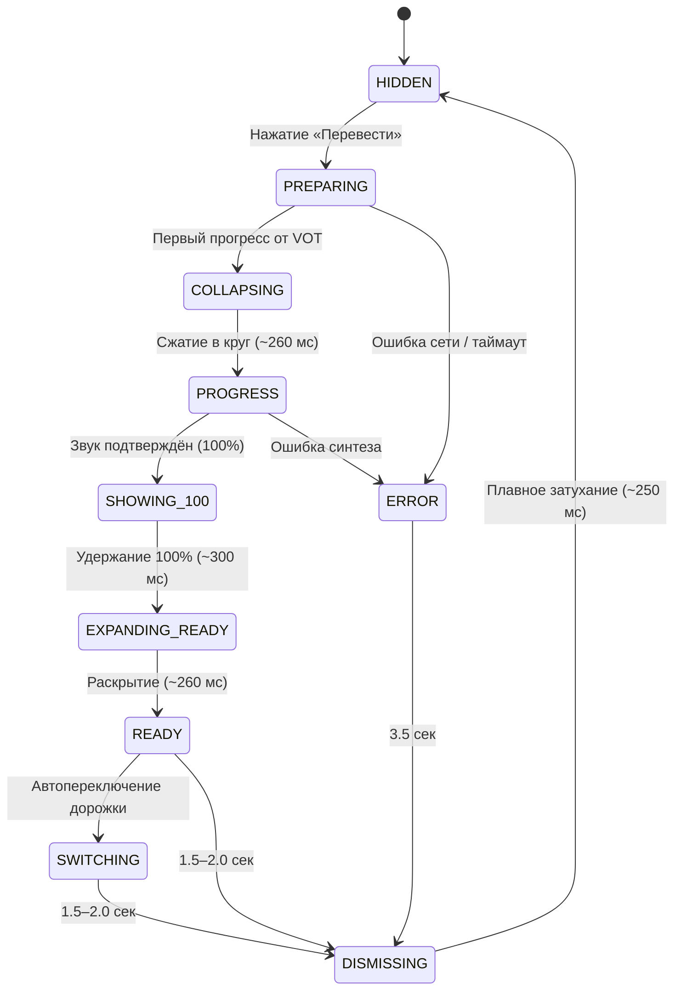

# SmartTube VOX: Спецификация HUD перевода (Финальный дизайн)

## 1. Обзор архитектуры

Плашка состояния голосового перевода (VOT HUD) спроектирована и реализована строго по утверждённому финальному макету (`media_1792349513945_51bb7524.jpg`).

### Фундаментальные принципы:
1. **Одна View, один Anchor**: плашка перевода представляет собой ровно один экземпляр View (`#vot_progress_root`), размещённый в правом боку экрана с фиксированным отступом справа (`marginEnd = 24dp`) и снизу (`bottomMargin = 256dp`).
2. **Фиксированный правый край**: правая координата плашки (`parent.getWidth() - 24dp`) инвариантна во всех состояниях. Морфинг между широкой плашкой (280dp) и круглым индикатором (56dp) осуществляется сужением/расширением левого края к/от неподвижного правого якоря.
3. **Единый конечный автомат (State Machine)**: состояния строго последовательны:
   `HIDDEN` → `PREPARING` → `COLLAPSING` → `PROGRESS (0–99%)` → `SHOWING_100 (100% hold)` → `EXPANDING_READY` → `READY` (или `SWITCHING`) → `DISMISSING` → `HIDDEN` (а также `ERROR`).
4. **Реальный бэкенд-прогресс**: процент от 0% до 100% генерируется строго реальными событиями (polling, ETA, upload parts, artifact ready = 99%, audible activation = 100%). Таймеры-имитаторы запрещены.
5. **Независимость от HUD управления плеером**: скрытие оверлея кнопок воспроизведения не двигает и не скрывает плашку перевода. Плашка не исчезает при перемотке или открытии настроек.

---

## 2. Геометрия и размеры (Source of Truth)

| Параметр | Значение | Описание |
|---|---|---|
| `RIGHT_MARGIN` | `24dp` | Фиксированный отступ от правого края экрана |
| `BOTTOM_MARGIN` | `256dp` | Фиксированный отступ снизу (безопасная зона над субтитрами и HUD) |
| `HEIGHT` | `56dp` | Фиксированная высота во всех состояниях |
| `WIDE_WIDTH` | `280dp` (240–320dp) | Ширина в раскрытой форме (Подготовка, Готово, Ошибка, Автопереключение) |
| `CIRCLE_SIZE` | `56dp x 56dp` | Размер в сжатом круглом режиме (Прогресс 0–100%) |
| `CORNER_RADIUS` | `28dp` | Радиус скругления (`height / 2`). В широкой форме — капсула, в 56x56 — идеальный круг |
| `INNER_PADDING` | `16dp` | Горизонтальный внутренний отступ слева и справа |
| `ICON_SIZE` | `24dp x 24dp` | Размер иконки статуса |
| `ICON_TEXT_GAP` | `16dp` | Зазор между иконкой и текстовым блоком |
| `TEXT_SIZE` | `16sp` | Шрифт текста состояния (`sans-serif-medium`) |
| `TEXT_LINE_HEIGHT` | ~`18sp` (`lineSpacingExtra=2dp`) | Межстрочный интервал |
| `TEXT_MAX_LINES` | `2` | Максимум 2 строки текста |

---

## 3. Цветовая палитра темы

| Токен | Hex | Использование |
|---|---|---|
| `vot_hud_bg` | `#CC0F1622` | Полупрозрачный фон плашки (80% непрозрачности) |
| `vot_hud_circle_bg` | `#CC0F1622` | Фон круга прогресса |
| `vot_hud_primary_accent` | `#1E90FF` | Основной синий акцент (дуга прогресса, иконка готово, иконка переключения) |
| `vot_hud_success` | `#00C853` | Акцент успеха |
| `vot_hud_info_accent` | `#4FC3F7` | Акцент инфо (звёздочки `ic_vot_sparkles`) |
| `vot_hud_primary_text` | `#FFFFFF` | Основной белый текст и внутренние контуры иконок |
| `vot_hud_secondary_text` | `#B0BEC5` | Вторичный текст |
| `vot_hud_ring_track` | `#22334A` | Тёмно-синяя направляющая кругового прогресса |
| `vot_hud_stroke` | `#331E90FF` | Тонкая стеклянная окантовка (1dp) |

---

## 4. Состояния и тайминги

### Детали состояний:
1. **ПОДГОТОВКА (`PREPARING`)**:
   - Широкая капсула 280dp x 56dp.
   - Иконка: `ic_vot_sparkles` (`#4FC3F7`, 24dp).
   - Текст: `«Подготовка\nперевода»` (16sp, `#FFFFFF`).
2. **ПРОГРЕСС (`PROGRESS`)**:
   - Круг 56dp x 56dp.
   - Индикатор: `VotProgressRingView` (толщина дуги 4.5dp, цвет `#1E90FF`, трек `#22334A`, начало с -90° по часовой стрелке).
   - Текст по центру: процент `0%`..`99%` (15sp BOLD, `#FFFFFF`).
3. **ЗАВЕРШЕНИЕ (`SHOWING_100`)**:
   - Круг 56dp x 56dp показывает `100%`.
   - Задержка удержания: `300 мс` (диапазон спецификации 200–400 мс).
4. **ГОТОВО (`READY`)**:
   - Раскрытие в капсулу 280dp x 56dp за `260 мс` (`FastOutSlowIn` / `Decelerate`).
   - Иконка: `ic_vot_ready` (синий круг `#1E90FF` с белой галочкой `#FFFFFF`, 24dp).
   - Текст: `«Перевод готов»` (16sp, `#FFFFFF`).
   - Время показа: `2000 мс` (1–2 сек).
5. **АВТОПЕРЕКЛЮЧЕНИЕ (`SWITCHING`)**:
   - Капсула 280dp x 56dp.
   - Иконка: `ic_vot_sync` (синий круг `#1E90FF` с двумя круговыми стрелками `#FFFFFF`, 24dp).
   - Текст: `«Переключаем\nна русский»` (16sp, `#FFFFFF`).
6. **ОШИБКА (`ERROR`)**:
   - Капсула 280dp x 56dp.
   - Иконка: `ic_vot_error` (красный круг с белым восклицательным знаком, 24dp).
   - Текст: `«Не удалось перевести»` (16sp, `#FFFFFF`).
   - Автозакрытие: `3500 мс`.
