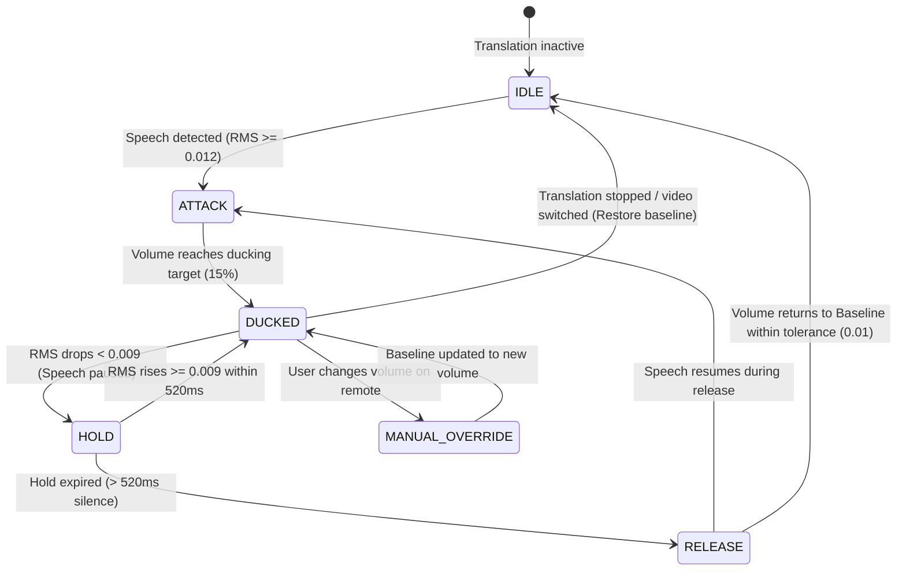

# VOT Smart Ducking / Adaptive Volume Reference: userscript v1.11.17

**Reference Version**: 1.11.17  
**Source Module**: `src/videoHandler/modules/ducking.ts` & `src/videoHandler/modules/smartDuckingRuntime.ts` (lines 40924–41400 in `docs/reference/vot.user.js`)

---

## 1. Core Principles

1. **Target of Analysis**: Only the **translated speech audio stream** (PCM time-domain data). The user's microphone is NEVER accessed.
2. **Dynamic Speech Gate**: When the translator speaks (RMS >= `thresholdOnRms`), original video volume is smoothly ducked down to `autoVolume` (default 15%).
3. **Hold / Silence Protection**: When speech pauses briefly (< `holdMs` = 520ms), the speech gate remains OPEN to prevent volume pumping during brief pauses between words or sentences.
4. **Smooth Envelope & Rate Limiting**: Exponential decay filter (`tau`) + slew rate limits (`maxDownPerSec = 3.5`, `maxUpPerSec = 0.9`) prevent sudden jarring volume jumps.
5. **Baseline Preservation**: The user's selected original volume `X` is strictly preserved as `baseline`. When translation stops or pauses, volume smoothly restores to exactly `X`.
6. **Manual Override Detection**: If the user adjusts volume during playback, the new level becomes the new `baseline` if delta > `externalBaselineDelta01` (0.02).
7. **Mute State Safety**: If target volume is 0%, original audio is muted. On stop, the previous mute state is restored faithfully.

---

## 2. Reference Constants (1:1 from userscript)

| Parameter | Value | Semantics |
|---|---|---|
| `tickMs` | `50 ms` | Interval between analysis ticks (20 ticks/sec) |
| `thresholdOnRms` | `0.012` | RMS threshold to open speech gate (speech detected) |
| `thresholdOffRms` | `0.009` | RMS threshold to close speech gate (hysteresis to prevent chatter) |
| `rmsAttackTauMs` | `60 ms` | Exponential smoothing tau for rising RMS envelope |
| `rmsReleaseTauMs` | `240 ms` | Exponential smoothing tau for falling RMS envelope |
| `holdMs` | `520 ms` | Grace period holding ducked state after speech falls below off-threshold |
| `attackTauMs` | `110 ms` | Exponential smoothing tau for ducking video volume downwards |
| `releaseTauMs` | `600 ms` | Exponential smoothing tau for releasing video volume upwards |
| `maxDownPerSec` | `3.5 / sec` | Maximum rate of volume decrease per second |
| `maxUpPerSec` | `0.9 / sec` | Maximum rate of volume increase per second |
| `rmsMissingGraceMs` | `200 ms` | Fallback hold if RMS data is temporarily delayed during playback |
| `maxDtMs` | `250 ms` | Maximum clamp for delta-time per tick |
| `externalBaselineDelta01`| `0.02` | Delta threshold to detect user's manual remote volume adjustments |
| `unduckTolerance01` | `0.01` | Delta within which unducked state is considered complete |
| `volumeStep01` | `0.01` | Quantization step for volume output |
| `applyDeltaThreshold01` | `0.005` | Threshold change required before invoking hardware/player volume update |

---

## 3. State Machine Transitions

---

## 4. Mathematical Formulas

### 4.1 RMS Calculation
For a window of $N$ audio PCM samples $s_i \in [-1.0, 1.0]$:
$$\text{RMS} = \sqrt{\frac{1}{N} \sum_{i=1}^N s_i^2}$$

### 4.2 Envelope Smoothing
$$\alpha_{\text{env}} = 1 - e^{-\Delta t / \tau_{\text{env}}}$$
$$\text{env}_{t} = \text{env}_{t-1} + (\text{RMS}_t - \text{env}_{t-1}) \cdot \alpha_{\text{env}}$$
where $\tau_{\text{env}} = 60\text{ms}$ if $\text{RMS}_t > \text{env}_{t-1}$ else $240\text{ms}$.

### 4.3 Volume Smoothing & Slew Rate Limiter
$$\alpha_{\text{vol}} = 1 - e^{-\Delta t / \tau_{\text{vol}}}$$
$$\tilde{V} = V_{\text{prev}} + (V_{\text{desired}} - V_{\text{prev}}) \cdot \alpha_{\text{vol}}$$
$$\Delta_{\text{max}} = (\text{rateLimit}) \cdot \Delta t_{\text{sec}}$$
$$V_{\text{next}} = \text{clamp}(\tilde{V}, V_{\text{prev}} - \Delta_{\text{max}}, V_{\text{prev}} + \Delta_{\text{max}})$$
where rateLimit is $3.5$ for downward ducking, $0.9$ for upward release.

---

## 5. Android TV Implementation Strategy

- **Audio Tap**: `AudioProcessor` in ExoPlayer/Media3 audio pipeline or `TeeAudioProcessor` off the main thread.
- **Detector**: Lightweight accumulator: counts sum of squares over 50ms frames; zero allocations per frame.
- **Fail-safe**: If detector encounters an error or audio tap underrun, ducking gracefully falls back to `classic` fixed ducking or `off`, ensuring translation playback is NEVER interrupted.
