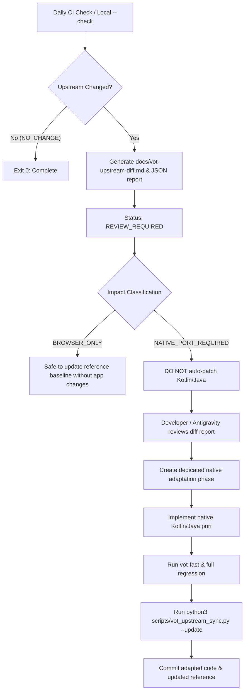

# VOT Upstream Synchronization & Drift Detection Infrastructure

## 1. Purpose & Motivation

SmartTube VOX achieves 100% native functional parity with the reference [VOT (Voice Over Translation) userscript](https://github.com/ilyhalight/voice-over-translation) for Android TV playback. Because VOT is an actively maintained open-source browser userscript, upstream releases periodically introduce:
- Protobuf schema updates (new fields, messages, wire types)
- Backend API endpoint additions or deprecations
- Audio mixing & Smart Ducking threshold adjustments
- Subtitle parsing, segmenting, and timing layout updates
- New user settings and storage keys

To maintain long-term parity without manual reverse engineering from scratch, this infrastructure provides **automated, deterministic structural drift detection**.

> [!IMPORTANT]
> **JavaScript Userscripts are NEVER Executed Inside the Android APK.**  
> SmartTube VOX contains **zero** WebViews, **zero** JS runtimes, and **zero** dynamic script evaluation. The userscript serves strictly as a canonical reference specification. All production features are implemented natively in Kotlin and Java over Android ExoPlayer and MediaCodec.

---

## 2. Authoritative Upstream Source

The upstream canonical source is pinned in `scripts/vot_upstream_sync.py`:
- **Repository**: [https://github.com/ilyhalight/voice-over-translation](https://github.com/ilyhalight/voice-over-translation)
- **Distribution Script URL**: `https://raw.githubusercontent.com/ilyhalight/voice-over-translation/master/dist/vot.user.js`
- **Current Canonical Reference**: `docs/reference/vot.user.js`
- **Baseline Metadata Snapshot**: `docs/reference/vot-reference.json`

---

## 3. Tooling & CLI Commands

The synchronization engine is located at `scripts/vot_upstream_sync.py`. It requires standard Python 3 and zero external dependencies.

### Check Status (Safe, Read-Only)
```bash
python3 scripts/vot_upstream_sync.py --check
```
- Fetches upstream distribution script into a temporary file.
- Validates integrity (`// ==UserScript==` headers, `@version`, `@name [VOT]`, minimum size > 50KB, non-HTML).
- Extracts structural AST (Protobuf messages, API endpoints, storage keys, ducking constants, `#region` hashes).
- Compares with local reference `docs/reference/vot.user.js`.
- Writes human-readable diff to `docs/vot-upstream-diff.md` and machine report to `build/reports/vot-upstream-diff.json`.
- **Does not modify local reference files.**

### Update Reference (Atomic Replacement)
```bash
python3 scripts/vot_upstream_sync.py --update
```
- If upstream is identical, reports `NO_CHANGE` and exits 0.
- If upstream has changed and passed all validations:
  1. Atomically replaces `docs/reference/vot.user.js` using `os.replace`.
  2. Updates baseline snapshot in `docs/reference/vot-reference.json`.
  3. Writes `docs/vot-upstream-diff.md` and `build/reports/vot-upstream-diff.json`.
- **Never modifies production Kotlin/Java code.**

### Run via Smart Test Suite
```bash
./scripts/run_smart_tests.sh vot-upstream-fast
```
Runs 22 offline unit tests validating parser accuracy, drift detection, network error taxonomy, and rollback safety.

---

## 4. Status Taxonomy

| Status | Meaning | Action |
|---|---|---|
| `NO_CHANGE` | Upstream version and SHA-256 match local reference exactly | No action needed. System is up to date. |
| `VERSION_CHANGED` | `@version` was bumped upstream (e.g. `1.11.17` -> `1.11.18`) | Triggers `REVIEW_REQUIRED`. Inspect `docs/vot-upstream-diff.md`. |
| `CONTENT_CHANGED_SAME_VERSION` | Content SHA-256 changed while `@version` remained identical | Triggers `REVIEW_REQUIRED`. Upstream commit altered code without version bump. |
| `ERROR` (`DNS_ERROR`, `TIMEOUT`, etc.) | Network or validation failure | Retried on next scheduled cycle; reference is preserved intact. |

---

## 5. Structural Diff Categories & Android Impact

The drift engine partitions changes into structured groups and assigns an Android impact rating:

1. **`NATIVE_PORT_REQUIRED`** (P0):
   - Protobuf message or field additions/removals/type changes.
   - Endpoint additions/removals in `/video-translation/*`, `/video-subtitles/*`, `/stream-translation/*`, or `/session/*`.
   - Core ducking thresholds or volume linking arithmetic changes in `src/videoHandler/modules/ducking.ts` or `volumeLink.ts`.
   - Core Yandex API client changes in `@vot.js/core/dist/providers/yandex.js`.
2. **`REVIEW_REQUIRED`** (P1):
   - New `votStorage` settings keys or config defaults.
   - Subtitle segmentation or timing logic adjustments in `src/subtitles/`.
3. **`BROWSER_ONLY`** (No Android TV Impact):
   - DOM scrapers for third-party websites (`PlyrHelper`, `BilibiliHelper`, `VideoJSHelper`, etc.).
   - Browser UI overlay components (`src/ui/views/overlay.ts`, lit-html templates).
   - Browser hotkeys and DOM event handlers.
4. **`NO_ANDROID_IMPACT`**:
   - Comments, whitespace, formatting, or documentation.

---

## 6. End-to-End Workflow When Upstream Changes



---

## 7. CI / GitHub Actions Automation

The workflow `.github/workflows/vot-upstream-check.yml`:
- Runs daily at `06:00 UTC` and on `workflow_dispatch`.
- Performs offline test suite verification followed by a live check against upstream master.
- Uploads `docs/vot-upstream-diff.md` and `build/reports/vot-upstream-diff.json` as job artifacts.
- Emits GitHub Actions warnings when `REVIEW_REQUIRED` is detected.
- **Does NOT create PRs, DOES NOT push commits, DOES NOT create releases, and DOES NOT auto-patch code.**
