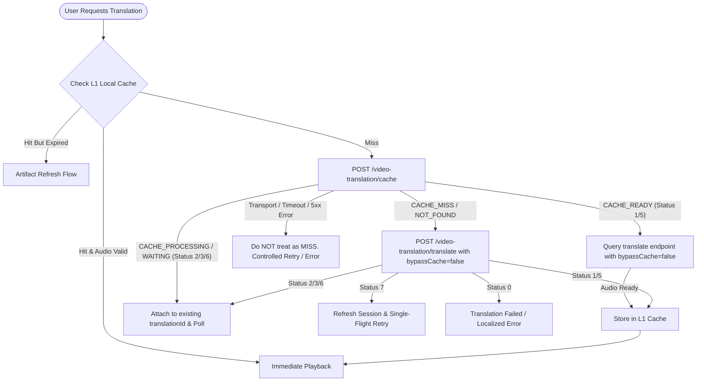

# VOT Protocol Reference & Wire Specification: userscript v1.11.17

**Reference Version**: 1.11.17  
**Reference SHA-256**: `4922bf1098224f545fb96a8de1202ba7a35166c144df5d39a05f69b4499ede6c`  
**Reference File**: `docs/reference/vot.user.js` (44,525 lines)  
**Host Target**: `api.browser.yandex.ru`  
**HMAC Key**: `bt8xH3VOlb4mqf0nqAibnDOoiPlXsisf`  
**Component Version**: `26.8.5.811`  
**User-Agent**: `Mozilla/5.0 (Windows NT 10.0; Win64; x64) AppleWebKit/537.36 (KHTML, like Gecko) Chrome/150.0.0.0 YaBrowser/26.8.0.0 Safari/537.36`

---

## 1. Protobuf Field Mapping Matrix

### 1.1 VideoTranslationRequest (`/video-translation/translate`)

| Field # | Wire Type | Field Name | Type | Reference v1.11.17 Default / Semantics | SmartTube Previous State | Target Parity Specification |
|---|---|---|---|---|---|---|
| 3 | 2 (Len) | `url` | string | Canonical Video URL (`https://youtu.be/<id>`) | Inconsistent (partially watch?v=) | Strict `https://youtu.be/<id>` |
| 4 | 2 (Len) | `deviceId` | string | Optional UUID device ID | Missing | Optional (null omitted) |
| 5 | 0 (Varint)| `firstRequest` | bool | `true` on initial translate, `false` on retry | Fixed `true` | Dynamic `firstRequest` (default true) |
| 6 | 1 (64bit) | `duration` | double | Real video duration in seconds (fallback 310.0) | Inconsistent duration | Real duration in seconds (>0) |
| 7 | 0 (Varint)| `unknown0` | bool | `true` (varint 1) | int32 1 | `true` (varint 1) |
| 8 | 2 (Len) | `language` | string | Normalized source language (e.g. "en", "" for auto) | sourceLang string | Normalized source ISO code |
| 9 | 0 (Varint)| `forceSourceLang` | bool | `false` | `false` | `false` |
| 10 | 0 (Varint)| `unknown1` | bool | `false` (varint 0) | int32 0 | `false` (varint 0) |
| 11 | 2 (Len) | `translationHelp` | repeated msg | `[{target: "video_file_url", targetUrl: ...}, {target: "subtitles_file_url", targetUrl: ...}]` | Missing in YandexVotProtobuf | Fully supported repeated message |
| 13 | 0 (Varint)| `wasStream` | bool | `false` for VOD, `true` if was livestream | Missing | Supported (default `false`) |
| 14 | 2 (Len) | `responseLanguage` | string | Target language ("ru") | "ru" | Target language ("ru") |
| 15 | 0 (Varint)| `unknown2` | bool | `true` (varint 1) | int32 1 | `true` (varint 1) |
| 16 | 0 (Varint)| `configVersion` | int32 | `2` | Missing in old encoders | Strictly `2` |
| 17 | 0 (Varint)| `bypassCache` | bool | `false` for normal flow; `true` only for force retranslate | Missing | Strictly `false` (default) |
| 18 | 0 (Varint)| `useLivelyVoice` | bool | `true` if lively voices enabled & permitted | boolean | Respects setting & language pair |
| 19 | 2 (Len) | `videoTitle` | string | Video title if available | Partial | Video title string |

### 1.2 VideoTranslationResponse (`/video-translation/translate`)

| Field # | Wire Type | Field Name | Type | Reference v1.11.17 Semantics | SmartTube Mapping |
|---|---|---|---|---|---|
| 1 | 2 (Len) | `url` | string | Audio stream URL (mp3/m4a CDN URL) | `audioUrl` |
| 2 | 1 (64bit) | `duration` | double | Audio duration in seconds | `durationSec` |
| 4 | 0 (Varint)| `status` | int32 | 0: FAILED, 1: FINISHED, 2: WAITING, 3: LONG_WAITING, 5: PART_CONTENT, 6: AUDIO_REQUESTED, 7: SESSION_REQUIRED | Enum / Status int with explicit constants |
| 5 | 0 (Varint)| `remainingTime` | int32 | Estimated remaining seconds | `remainingTimeSec` |
| 6 | 0 (Varint)| `unknown0` | int32 | Internal flag | Ignored / preserved |
| 7 | 2 (Len) | `translationId` | string | Unique translation task ID | `translationId` |
| 8 | 2 (Len) | `language` | string | Detected / returned source language | `sourceLang` |
| 9 | 2 (Len) | `message` | string | Status / error message (e.g. "обычная озвучка") | `message` |
| 10 | 0 (Varint)| `isLivelyVoice` | bool | Whether lively voice was synthesized | `isLivelyVoice` |
| 11 | 0 (Varint)| `allowToTranslateVideo` | bool | Whether translation is permitted | `allow` |
| 12 | 0 (Varint)| `shouldRetry` | int32 | Server retry directive | `shouldRetry` |

### 1.3 VideoTranslationCacheRequest (`/video-translation/cache`)

| Field # | Wire Type | Field Name | Type | Reference v1.11.17 Semantics |
|---|---|---|---|---|
| 1 | 2 (Len) | `url` | string | Canonical Video URL (`https://youtu.be/<id>`) |
| 2 | 1 (64bit) | `duration` | double | Video duration in seconds (must match translate request) |
| 3 | 2 (Len) | `language` | string | Source language code |
| 4 | 2 (Len) | `responseLanguage` | string | Target language code ("ru") |

### 1.4 VideoTranslationCacheResponse (`/video-translation/cache`)

| Field # | Wire Type | Field Name | Type | Reference v1.11.17 Semantics |
|---|---|---|---|---|
| 1 | 2 (Len) | `default` | Item | Status for standard voice synthesis |
| 2 | 2 (Len) | `cloning` | Item | Status for lively voice (voice cloning) |

**Item Submessage (`VideoTranslationCacheItem`)**:
- 1 (Varint): `status` (int32: 0=FAILED, 1=FINISHED, 2=WAITING, 3=LONG_WAITING, 5=PART_CONTENT, 6=AUDIO_REQUESTED, 7=SESSION_REQUIRED)
- 2 (Varint): `remainingTime` (int32)
- 3 (Length): `message` (string)
- 4 (Varint): `unknown0` (int32)
- 5 (Varint/Packed): `flags` (repeated int32)

---

## 2. Authentication, Signatures & Headers

### 2.1 Request Signatures
1. **`Vtrans-Signature`**: HMAC-SHA256 of request protobuf body using key `bt8xH3VOlb4mqf0nqAibnDOoiPlXsisf`.
2. **`Sec-Vtrans-Token`**: `HMAC(uuid:path:version):uuid:path:version`
3. **`Sec-Vtrans-Sk`**: `secretKey` received from `/session/create`.

### 2.2 Standard Request Headers
```http
Accept: application/x-protobuf
Accept-Language: en
Content-Type: application/x-protobuf
User-Agent: Mozilla/5.0 (Windows NT 10.0; Win64; x64) AppleWebKit/537.36 (KHTML, like Gecko) Chrome/150.0.0.0 YaBrowser/26.8.0.0 Safari/537.36
Pragma: no-cache
Cache-Control: no-cache
Vtrans-Signature: <hex-signature>
Sec-Vtrans-Token: <token-string>
Sec-Vtrans-Sk: <secret-key>
```
*(If OAuth token provided and lively voice requested: `Authorization: OAuth <token>`)*

---

## 3. Dedicated Server Cache Flow vs Normal Translate Flow


